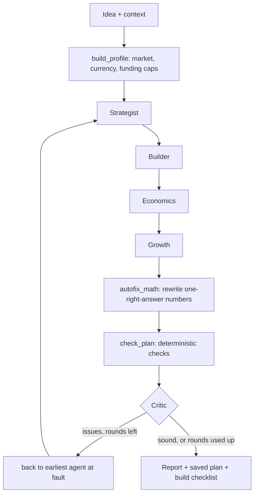

# Parakh

**Your own AI co-founder.** Type your startup idea in one sentence. Four AI agents write a build plan with real tools and real prices, Python checks every number they produce, and a Critic sends back whatever won't hold up.

Built for the BharatCode Build League. Every model call runs on [BharatCode](https://bharatcode.ai).

> *Parakh* (परख) means the act of testing something to find out if it's genuine. That's the job: test your idea before you spend months on it.

## Why it's different

Language models write confident plans with broken arithmetic. A runway of 18 months when capital divided by burn is 7. Monthly revenue that doesn't equal customers times price. Most AI planners pass that straight to you.

Parakh splits the work:

- **Math is checked by math.** Before any review, `autofix_math` recomputes the numbers that have exactly one right answer (burn total, runway, break-even, MRR, CAC) and rewrites them. `check_plan` then runs deterministic checks on everything else: burn equals the sum of its line items, CAC stays below three months of revenue, channels can actually deliver the Day 30 target, bootstrapped plans stay under their caps.
- **Judgement is checked by an LLM.** Only what code can't settle (does this fit the founder's constraints, is it realistic, is it vague) goes to the Critic.
- **Every problem goes to its owner.** Each agent owns one slice of the plan. When something breaks, the graph sends it back to the earliest agent at fault and re-runs it plus everything downstream, up to two revision rounds.

## How it works

| Agent | Owns | Lens |
|---|---|---|
| Strategist | business type, problem, customer, mission, competitors, scope cuts | what problem, for whom, what we won't build |
| Builder | stack, AI tools, MVP features, tool costs, first 10 steps | what to build, with real tool prices |
| Economics | pricing, burn line items, runway, break-even, Day 30/60/90 targets | unit economics |
| Growth | channels, CAC, first 10 customers, cold message, objections | 30-day go-to-market |
| Critic | verdict, biggest risk, constraint adherence score | everything code can't check |



The run streams live to the browser over Server-Sent Events, so you watch each agent work and see what the checks caught.

## Built on BharatCode

All LLM access lives in one file, [`agents/llm_router.py`](agents/llm_router.py). It uses the official `openai` Python SDK pointed at BharatCode's OpenAI-compatible endpoint:

- Base URL: `https://bharatcode.ai/api/model/v1`
- Model: `qwen-3.8-27b` for every agent (set `PARAKH_MODEL` to change it)
- `PARAKH_CRITIC_MODEL` gives the Critic its own model, so it doesn't grade output from the model that wrote it
- Busy-server and rate-limit responses are retried with backoff
- Visitors can bring their own BharatCode key. It's sent in an `X-BharatCode-Key` header and never stored.

## Run it locally

You need Python 3.10+, Node 18+, a BharatCode API key and a Supabase project.

```bash
git clone https://github.com/mayankmalik263/parakh.git
cd parakh

python -m venv venv
venv\Scripts\activate            # macOS/Linux: source venv/bin/activate
pip install -r requirements.txt

cp .env.example .env              # then fill in BHARATCODE_API_KEY, SUPABASE_URL, SUPABASE_KEY
uvicorn api:app --reload
```

```bash
cd parakh-frontend
npm install
# .env.local: NEXT_PUBLIC_API_URL, NEXT_PUBLIC_SUPABASE_URL, NEXT_PUBLIC_SUPABASE_ANON_KEY
npm run dev
```

Open `http://localhost:3000`. The `supabase_*.sql` files create the tables; run `supabase_auth_migration.sql` last.

No frontend? `python main.py` runs one plan in the terminal. `pytest` runs the test suite; it fakes every model call, so it needs no key.

## Project layout

```
agents/              one file per agent, plus llm_router.py (BharatCode) and context_block.py (profile, caps)
graph_orchestrator.py  the LangGraph state machine and revision loop
evaluation_engine.py   autofix_math, check_plan, and the evaluation suite
api.py               FastAPI: /simulate, SSE stream, /clarify, council chat, evals, checklist
models.py            Pydantic schemas for every agent's slice
parakh-frontend/     Next.js 16 + Tailwind v4 app
tests/               pytest suite
```

## Credits

Parakh is the work of [Mayank Malik](https://github.com/mayankmalik263). It grew out of his earlier project, [MASS](https://github.com/mayankmalik263/Mass-Multi-Agent-STARTUP-Simulator-), whose verify-and-repair engine it builds on. MIT licensed.
