<div align="center">

# Parakh <sub>परख</sub>

### Your own AI co-founder, built for student founders in India

Type your startup idea in one line. Four AI agents plan it in rupees, plain Python rechecks every number they write, and a Critic tells you straight what won't hold up.

[](https://bharatcode.ai)
[](BharatCode.txt)
[](LICENSE)


<a href="https://parakh-xyz.vercel.app/"></a>

[Features](#what-parakh-does) · [How it works](#how-it-works) · [AI providers](#ai-providers-bharatcode-first) · [Results](#measured-results) · [Run it locally](#run-it-locally) · [Deploy](#deploy) · [API](#api-reference)

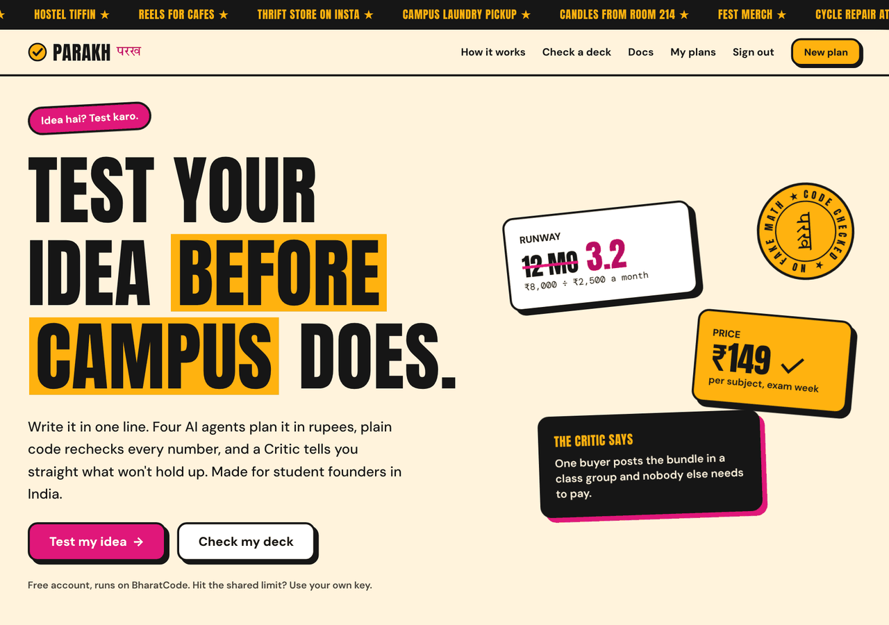

</div>

**Live:** [parakh-xyz.vercel.app](https://parakh-xyz.vercel.app/). Sign up free, type one line, and get your plan in about two minutes.

> **Parakh** (परख) means testing something to find out if it's genuine. That's the job: test your idea before you spend months on it.

---

## Table of contents

- [Why Parakh exists](#why-parakh-exists)
- [What Parakh does](#what-parakh-does)
- [A tour in screenshots](#a-tour-in-screenshots)
- [How it works](#how-it-works)
  - [The five agents](#the-five-agents)
  - [The pipeline](#the-pipeline)
  - [Math is checked by math](#math-is-checked-by-math)
  - [Checked tool prices](#checked-tool-prices)
  - [The Critic and revisions](#the-critic-and-revisions)
  - [Full context for every agent, fewer tokens](#full-context-for-every-agent-fewer-tokens)
- [AI providers: BharatCode first](#ai-providers-bharatcode-first)
- [Measured results](#measured-results)
- [Tech stack](#tech-stack)
- [Run it locally](#run-it-locally)
- [Configuration](#configuration)
- [Testing](#testing)
- [Deploy](#deploy)
- [API reference](#api-reference)
- [Scripts](#scripts)
- [Project layout](#project-layout)
- [Privacy and security](#privacy-and-security)
- [Known limits](#known-limits)
- [Built for the BharatCode Build League](#built-for-the-bharatcode-build-league)
- [Credits and license](#credits-and-license)

---

## Why Parakh exists

Ask a chatbot for a startup plan and you get a confident document with broken arithmetic. Runway says 18 months when capital divided by burn is 7. Monthly revenue doesn't equal customers times price. The tool it recommends costs money it never mentioned, or isn't even available in India. And it assumes you have a team, an office and a seed round.

Most student founders have none of that. They have savings, about 15 hours a week around classes, and a campus full of first customers.

Parakh is built for them. Unless you say otherwise, it plans for a student in India spending their own money, then makes sure every number in the plan adds up before you see it.

---

## What Parakh does

### 📋 A build plan from one sentence

You write one line, answer a few quick questions, and watch five agents work live. You get:

- **Who pays and why:** the problem, the exact customer, the mission, real competitors, and what you're deliberately *not* building.
- **What to build it with:** a stack and AI tools with real plan names and checked prices, the MVP features, and the first 10 steps you can start tonight.
- **The money:** pricing tiers, every line of monthly burn, runway, break-even and Day 30, 60 and 90 revenue targets.
- **The first customers:** channels with spend and cost per customer, a first-10-customers playbook, a cold message ready to send, and answers to the objections you'll hear.
- **The Critic's verdict:** the biggest risk and every issue it found, each with a fix.
- **A tick-off checklist** saved to your dashboard, with progress.

### 🎓 Student mode by default

A blank market means India. Prices are in rupees, with UPI and Razorpay instead of Stripe. A student founder gets:

| Limit | Default |
|---|---|
| MVP build cost | at most ₹15,000 |
| Running costs before revenue | under ₹10,000 a month |
| Time | about 15 hours a week, around classes |
| First customers | campus first: class WhatsApp groups, fests, Instagram, shops near the gate |

Say you're full time, working, selling abroad or raising money, and the limits change to fit.

### 🔎 Deck check

Got a pitch deck? Drop in up to 3 slide screenshots or paste the numbers. Python recomputes runway, break-even, MRR and cost per customer from **what the deck itself says**, and shows the formula for every figure that's off:

> *Runway says 12 months, but ₹2,00,000 ÷ ₹40,000 a month is 5.0 months.*

Then the Critic goes after claims math can't check, like "we only need 1% of the market". Try it with [`examples/sample-deck-slide.png`](examples/sample-deck-slide.png), which has four planted mistakes. Nothing you upload is stored.

### 🤖 Pick your AI

BharatCode runs everything by default, free on the shared quota. If you already pay for OpenAI, Claude, Gemini or OpenRouter, you can run plans on your own API key instead. The key stays in your browser. [More below.](#ai-providers-bharatcode-first)

### 💬 Ask the agents

After the plan, ask follow-ups like "@Economics what if I charge ₹99?" and get answers grounded in your plan's numbers, in English or **Hinglish**. Pick an agent with one click, and the answer comes back formatted, with the working shown.

<div align="center">
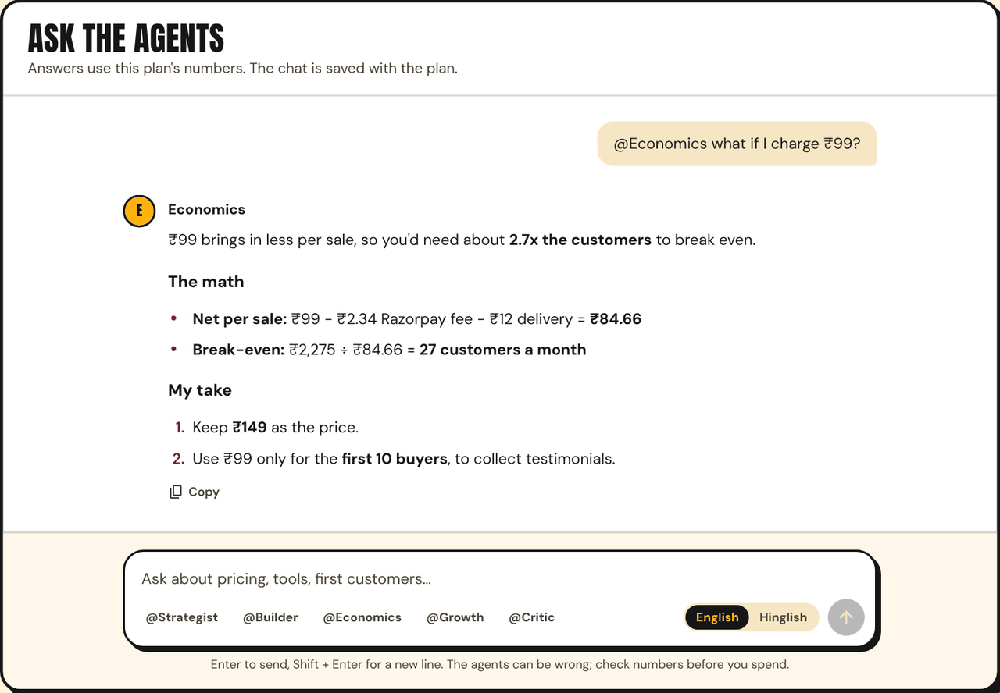
</div>

### 🔗 Share, privately by default

Plans are private. Turn on a read-only public link if you want feedback. A shared link shows the plan only, never your answers or your chat.

### 💸 Know what each plan cost

Every plan ends with one quiet line: which AI made it, how many model calls and tokens it used, how long it took, and, on a paid key, roughly what it cost you.

---

## A tour in screenshots

<table>
<tr>
<td width="50%">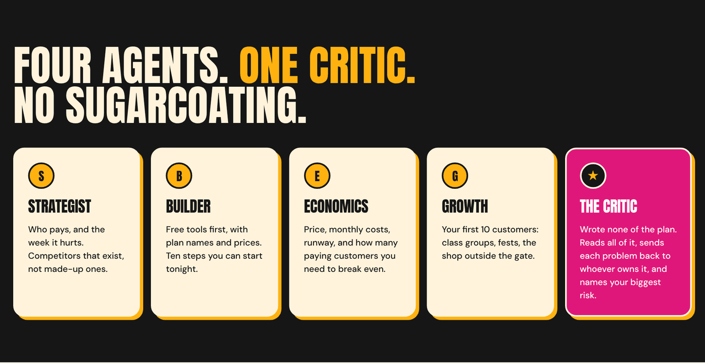<br><sub><b>Four agents, one Critic.</b> Each agent owns one part of the plan.</sub></td>
<td width="50%">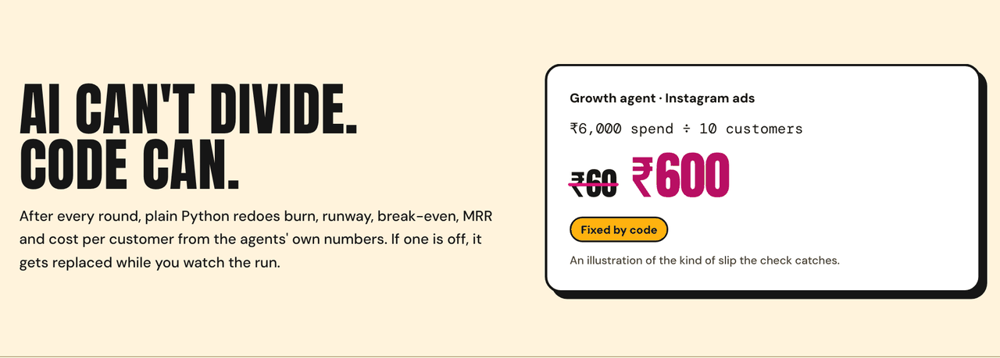<br><sub><b>AI can't divide. Code can.</b> Wrong numbers are replaced while you watch.</sub></td>
</tr>
<tr>
<td>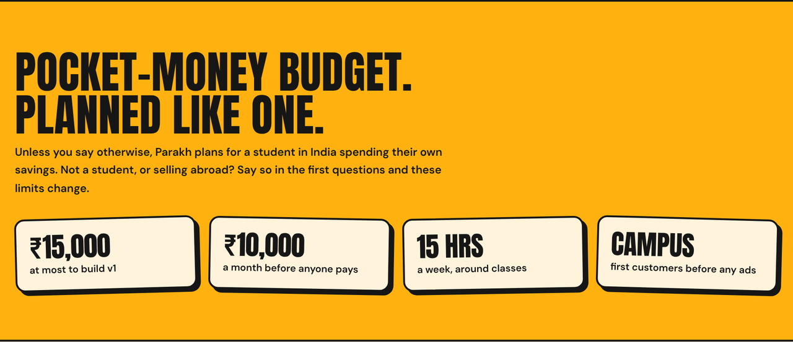<br><sub><b>Pocket-money budget.</b> Student limits apply unless you say otherwise.</sub></td>
<td>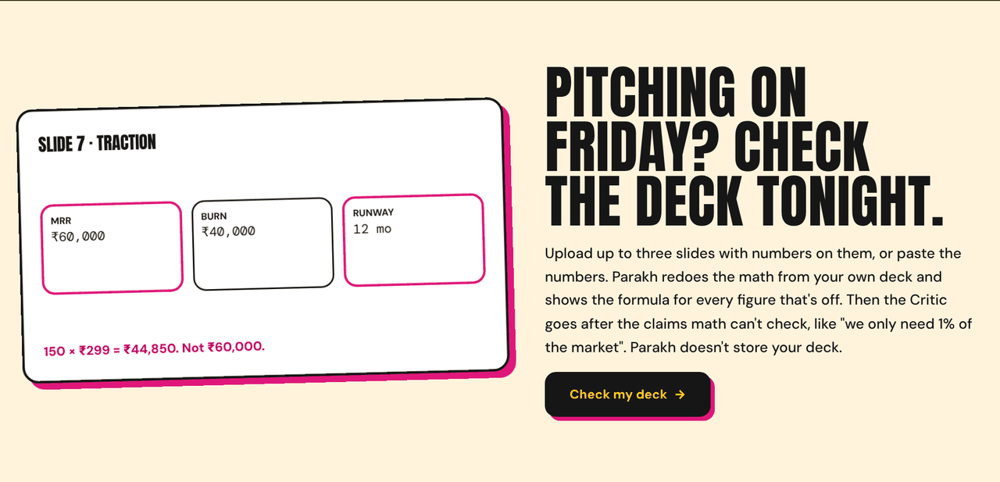<br><sub><b>Deck check.</b> 150 × ₹299 is ₹44,850, not ₹60,000.</sub></td>
</tr>
<tr>
<td>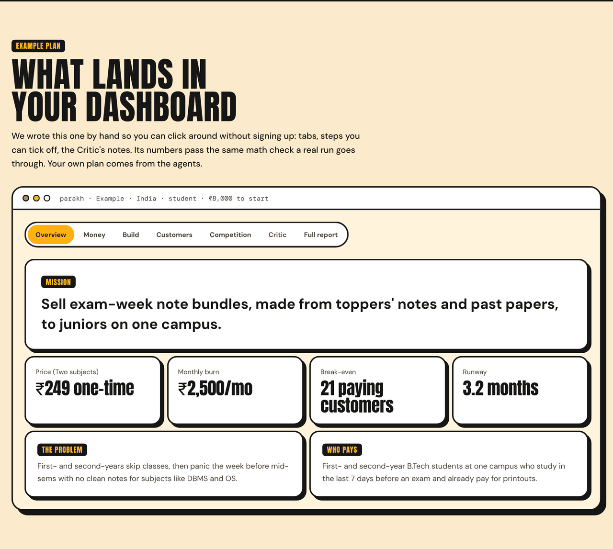<br><sub><b>The plan, Overview tab.</b> Mission, price, burn, break-even, runway.</sub></td>
<td>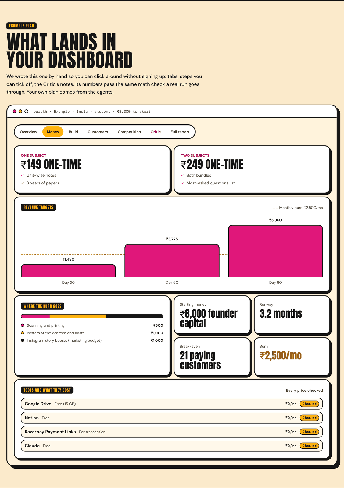<br><sub><b>Money tab.</b> Pricing, revenue targets, where the burn goes, checked tool prices.</sub></td>
</tr>
<tr>
<td>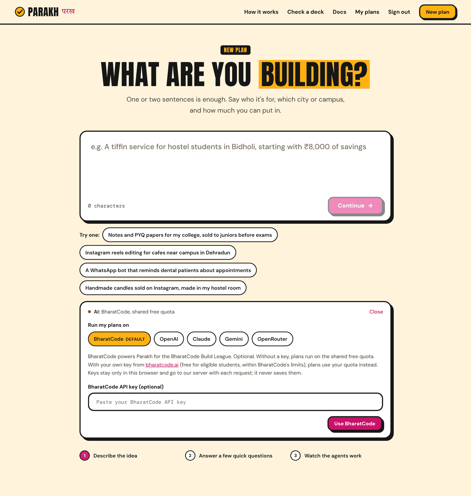<br><sub><b>New plan.</b> One line, a few examples to try, and the AI picker.</sub></td>
<td>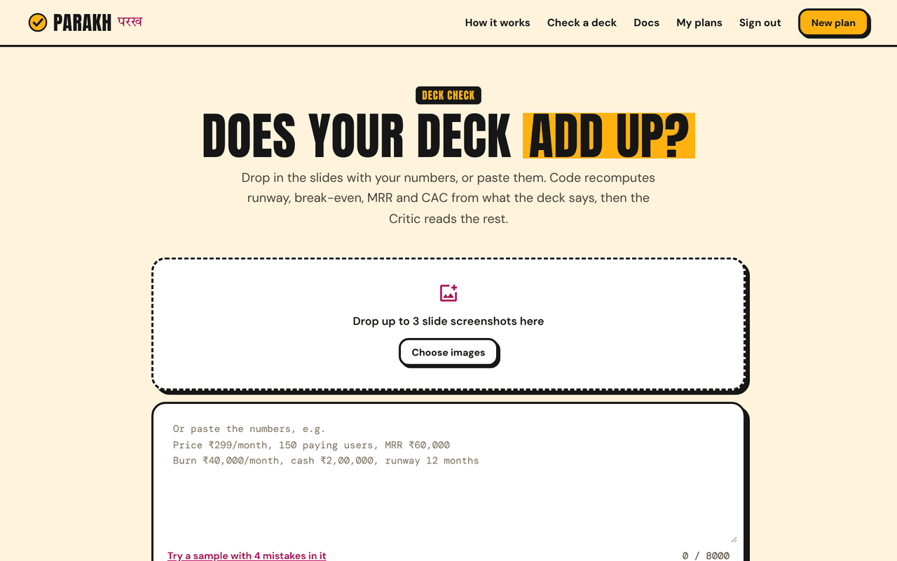<br><sub><b>Does your deck add up?</b> Slides or pasted numbers.</sub></td>
</tr>
</table>

The plan screenshots show the landing page's example plan ("notes for juniors", ₹8,000 to start). It was written by hand and passes the same math checks as a real run. Your own plan comes from the agents.

---

## How it works

### The five agents

Each agent owns exactly one slice of the plan as validated JSON. Nobody edits anyone else's numbers.

| Agent | Owns | Thinks about |
|---|---|---|
| 🧭 **Strategist** | business type, problem, customer, mission, competitors, scope cuts | who pays, and the week it hurts |
| 🛠️ **Builder** | stack, AI tools, MVP features, tool costs, build cost, first 10 steps | free tools first, real plan names and prices |
| 📊 **Economics** | pricing tiers, burn line items, runway, break-even, Day 30/60/90 targets | unit economics that survive a calculator |
| 📣 **Growth** | channels, cost per customer, first-10 playbook, cold message, objections | where the first 10 customers come from |
| ⚖️ **Critic** | verdict, biggest risk, constraint adherence score, issues | everything code can't check |

### The pipeline

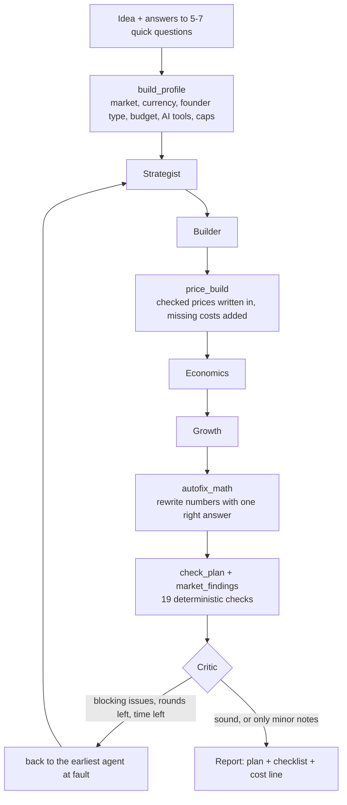

The run streams to the browser over Server-Sent Events, so you see each agent start and finish, what code corrected, and what the Critic sent back.

**Before the run**, `/clarify` asks five fixed questions (market, who's building, funding, budget, and which AI subscription you already pay for) and two more written for your idea (who exactly pays, and how). Paying for ChatGPT, Claude or Gemini changes the plan: the Builder leans on the AI you already have, for example editing reels with Claude Code plus FFmpeg, Whisper and HyperFrames instead of a paid video editor.

### Math is checked by math

Language models are bad at arithmetic and good at sounding sure. So Parakh never asks a model whether a number is right.

**`autofix_math`** recomputes every number that has exactly one right answer and rewrites it in place: burn total, runway, break-even customers, MRR at each target, and cost per customer for each channel. No revision round is ever spent on arithmetic.

**`check_plan`** then runs deterministic checks and addresses each finding to the one agent who owns the broken field:

<details>
<summary><b>All 19 checks</b></summary>

| Owner | Check |
|---|---|
| Builder | MVP build cost is within the founder's cap |
| Builder | no tool the founder can't use in their market (e.g. CapCut is banned in India) |
| Economics | monthly burn equals the sum of its line items |
| Economics | burn line items cover at least the Builder's tool costs |
| Economics | marketing budget isn't larger than the whole burn |
| Economics | runway equals starting capital ÷ monthly burn |
| Economics | customers actually pay something |
| Economics | delivery cost per customer is below the price |
| Economics | break-even equals ⌈burn ÷ (price − delivery cost)⌉ |
| Economics | MRR at each target equals paying customers × price |
| Economics | MRR never drops between targets |
| Economics | starting capital matches what the founder said they can put in |
| Economics | no outside funding for a bootstrapped founder |
| Economics | monthly burn is within the founder's cap |
| Growth | channel spend matches the marketing budget |
| Growth | each channel's cost per customer equals spend ÷ customers |
| Growth | cost per customer stays below 3 months of revenue per customer |
| Growth | channels can deliver the Day 30 target |
| Growth | channels and Economics agree on how many customers arrive |

</details>

What code can't fix on its own reaches the plan as a visible warning. The deck check reuses the same idea through `check_claims`: it only uses numbers the deck states, and a missing input skips that check instead of guessing.

### Checked tool prices

Models remember prices from their training data, and those go stale. Parakh doesn't let a model quote prices.

[`tool_catalog.json`](tool_catalog.json) lists **58 tools** across hosting, payments, AI assistants, AI coding, video, storefronts, automation, shipping and more. Every plan price comes with the page it was read from and the day it was checked (2 Nov 2026). Dollar prices convert at a dated rate (₹94.98 per $1 from x-rates.com, same day).

After the Builder runs, [`tool_catalog.py`](tool_catalog.py):

- writes the checked price into every cost line it recognises, and shows what it corrected,
- adds a cost line for any recommended tool the Builder forgot to price, so there are no hidden costs,
- marks prices it can't check as unverified, so you know to confirm them,
- flags tools that don't work in your market.

A few things the catalog caught that a model would get wrong: CapCut is banned in India. Vercel's free Hobby plan is for non-commercial use only, so Parakh suggests Netlify or Cloudflare Pages for a business. Cursor's plans changed. Indian students can get Google AI Plus free.

[`scripts/check_tool_prices.py`](scripts/check_tool_prices.py) re-reads every pricing page and reports which listed prices it can no longer find, so the list can be refreshed weekly by hand.

### The Critic and revisions

The Critic reads the whole plan with the code's findings already listed, so it doesn't repeat them. It judges what code can't settle:

1. **Fidelity:** is this still the founder's idea, or did an agent swap the business?
2. **Fit to business type:** a service needs pilots and contracts, not an app build.
3. **Constraint fit:** funding mode, currency, caps, market.
4. **Realism:** would this price and channel survive the real customer?
5. **Coherence:** do strategy, build and growth describe the same business?
6. **Vagueness:** could the founder start each step within 60 minutes?
7. **Founder fit:** does it fit 15 hours a week and a savings-sized budget?

Each issue is either **blocking** (the founder would make a bad decision or get stuck) or **minor** (worth knowing, the plan still works). Only code findings and blocking issues send a section back. The graph re-runs the earliest agent at fault and everything after it, for at most 2 revision rounds, and a second round only happens if the first finished within a time budget. Minor issues stay in the plan as notes.

### Full context for every agent, fewer tokens

Every agent sees the full picture: the founder's context, the hard rules, and the plan so far. That context is built once per step and sent as the same **shared prefix** at the start of every prompt, which is exactly what provider prompt caches reuse. On top of that:

- Schemas go to the model as a compact template instead of a full JSON Schema.
- Revisions send the issues to fix, not the whole previous output again.
- Lists are capped and long fields trimmed in code, so one runaway answer can't fail a run.
- Qwen's thinking mode is switched off for BharatCode, with an automatic retry if a reply comes back empty.
- A stray word after the closing brace of a JSON reply is cut off in code instead of asking the model again.

The [results](#measured-results) show what this saved.

---

## AI providers: BharatCode first

BharatCode is the default, listed first in the picker, and runs the live demo. Founders who already pay for another AI can use it instead with their own key.

<div align="center">
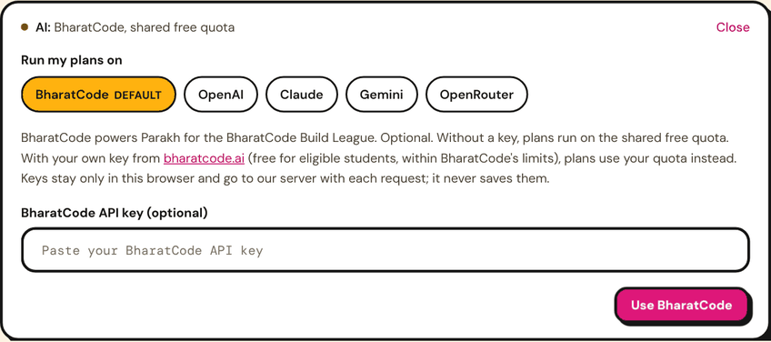
</div>

| Provider | Default model | Key | How Parakh calls it |
|---|---|---|---|
| **BharatCode** (default) | `qwen-3.8-27b` | optional: the server's shared key, or your own | OpenAI SDK at `https://bharatcode.ai/api/model/v1` |
| OpenAI | `gpt-6-luna` | your own | OpenAI SDK, `max_completion_tokens`, no sampling params |
| Claude | `claude-sonnet-5-5` | your own | `anthropic` SDK with prompt caching on the shared prefix |
| Gemini | `gemini-2.5-flash` | your own | Gemini's OpenAI-compatible endpoint |
| OpenRouter | you type the model id | your own | OpenRouter's OpenAI-compatible endpoint |

- **One model runs all five agents.** You can type a different model for any provider except BharatCode.
- **Your key never leaves your browser except with your own requests.** The browser keeps the provider, model and key in localStorage and sends them as `X-Parakh-Provider`, `X-Parakh-Model` and `X-Parakh-Key`. The server uses the key for that request only, never stores or logs it, and never falls back to its own BharatCode key for another provider.
- **API use is billed by the provider** to your account, separately from a ChatGPT, Claude or Gemini chat subscription.
- **Clear errors.** A wrong key, a model your account can't use, an unknown model name or a rate limit each get a plain message, and the picker opens so you can fix it.
- **JSON mode adapts.** If a model rejects JSON mode, Parakh stops sending it for that provider and relies on the prompt.

**The cost line.** Every plan records its calls, input, output and cached tokens, and time. For paid providers it estimates the cost from the per-million-token prices in `MODEL_PRICES` ([`agents/providers.py`](agents/providers.py)), read from each provider's pricing page on 2 Nov 2026. Cached tokens are counted at the cached price where the provider publishes one, and at the full input price where it doesn't, so the estimate errs high. Models without a known price show "cost not estimated" instead of a guess. Prices change, so re-check them before you rely on the number.

<details>
<summary><b>BharatCode details</b></summary>

- All model access goes through one file, [`agents/llm_router.py`](agents/llm_router.py), using the official `openai` Python SDK.
- Base URL `https://bharatcode.ai/api/model/v1`, model `qwen-3.8-27b`. Set `PARAKH_MODEL` to change it.
- `PARAKH_CRITIC_MODEL` gives the Critic its own model, so it doesn't grade output from the model that wrote it. `PARAKH_VISION_MODEL` sets a separate model for reading deck images.
- Thinking is switched off per request (`chat_template_kwargs.enable_thinking = false`). If a reply still comes back empty, Parakh retries once with a bigger budget and Qwen's `/no_think` switch. Any `<think>` block is stripped.
- Busy-server and rate-limit answers are retried with backoff (up to 5 attempts, honouring `Retry-After`).
- A 402 or 403 (for example, a student account that isn't verified yet) stops the run before the questions, with a message that says what to do.
- Deck slides go to the model as images in the OpenAI vision format. If the model on your key doesn't accept images, the app asks for pasted numbers instead.
- Visitors can bring their own BharatCode key to use their own quota. The older `X-BharatCode-Key` header still works.

</details>

---

## Measured results

Parakh ships with an evaluation harness ([`scripts/eval/`](scripts/eval)) that runs the whole pipeline on a fixed set of 12 student-founder ideas, from "notes and PYQ papers sold to juniors" and "tiffin delivery for hostel students in Bidholi" to "invoicing for freelance designers in the US". Nothing is saved to Supabase and past lessons are switched off, so runs are comparable.

Here is the version before the token and price work (**baseline**) against the current pipeline (**step 2**), both on BharatCode `qwen-3.8-27b`, averaged per plan over all 12 ideas:

| Per plan | Baseline | Now | Change |
|---|---:|---:|---:|
| Tokens | 32,336 | 24,458 | **−24%** |
| Output tokens | 6,959 | 4,343 | **−38%** |
| Time | 290 s | 136 s | **−53%** |
| Model calls | 9.2 | 6.9 | −25% |
| Revision rounds | 1.08 | 0.75 | −31% |
| Math errors left unfixed | 0.17 | 0 | **−100%** |
| Recommended tools with no cost line | 2.6 | 0 | **−100%** |
| Statistics with no source | 0.8 | 0.2 | −70% |
| All tool prices matching the checked list | 50 of 72 | 115 of 120 | 69% → 96% |

Full per-idea tables are in [`scripts/eval/results/`](scripts/eval/results). Your numbers will differ with server load and model version.

---

## Tech stack

| Layer | What |
|---|---|
| Agents | Python, [LangGraph](https://github.com/langchain-ai/langgraph) state machine, Pydantic v2 schemas for every slice |
| API | FastAPI, background jobs, Server-Sent Events for the live run |
| Models | BharatCode `qwen-3.8-27b` by default through the `openai` SDK; OpenAI, Claude (`anthropic` SDK), Gemini and OpenRouter with your own key |
| Data and auth | Supabase: Postgres with row-level security, Supabase Auth (JWT checked on every request) |
| Frontend | Next.js 16, React 19, Tailwind CSS v4, TypeScript |
| Design | "Tapri poster": Anton, DM Sans, DM Mono and Tiro Devanagari Hindi, cream and marigold with hard ink shadows |
| Hosting | Render (API, [`render.yaml`](render.yaml) blueprint) and Vercel (frontend) |
| Tests | pytest, every model call faked, so it runs without a key |

---

## Run it locally

**You need:** Python 3.10 or newer, Node 18 or newer, a Supabase project, and a BharatCode API key ([bharatcode.ai](https://bharatcode.ai); eligible students get free access, subject to BharatCode's current limits).

### 1. Backend

```bash
git clone https://github.com/mayankmalik263/parakh.git
cd parakh

python -m venv venv
venv\Scripts\activate             # macOS / Linux: source venv/bin/activate
pip install -r requirements.txt

copy .env.example .env            # macOS / Linux: cp .env.example .env
# open .env and fill in BHARATCODE_API_KEY, SUPABASE_URL, SUPABASE_KEY

uvicorn api:app --reload --port 8000
```

Open `http://localhost:8000/` and you should see `{"status": "Parakh API running"}`. Interactive API docs are at `/docs`.

> **Windows tip:** if uvicorn fails with `WinError 10013`, the port is reserved. Use another one, for example `--port 8010`, and point the frontend at it.

### 2. Database

In the Supabase SQL editor (**SQL Editor → New query**), run these files in this order on a new project:

1. `supabase_auth_schema.sql`: the `simulations` table, owned per user. ⚠️ It drops an existing `simulations` table first, so don't run it on a project with plans you want to keep.
2. `supabase_checklist_schema.sql`: the build checklist.
3. `supabase_eval_schema.sql`: evaluation runs and agent lessons.
4. `supabase_auth_migration.sql`: chat history and the remaining per-user columns. Safe to re-run.
5. `supabase_share_migration.sql`: public share links.

`supabase_schema.sql` is the original single-user table from MASS. A new project doesn't need it.

### 3. Frontend

```bash
cd parakh-frontend
npm install
```

Create `parakh-frontend/.env.local`:

```bash
NEXT_PUBLIC_API_URL=http://localhost:8000
NEXT_PUBLIC_SUPABASE_URL=your_supabase_project_url
NEXT_PUBLIC_SUPABASE_ANON_KEY=your_supabase_anon_key
```

```bash
npm run dev
```

Open `http://localhost:3000`, sign up, and run your first idea. If the frontend runs on a different port (say 3001), add it to `ALLOWED_ORIGINS` in the backend `.env`, or the browser will block requests.

### No frontend? Use the terminal

```bash
python main.py
```

Asks for an idea and a few answers, then runs the full pipeline and saves the plan to `outputs/`.

---

## Configuration

<details open>
<summary><b>Backend <code>.env</code></b></summary>

| Variable | Required | Default | What it does |
|---|---|---|---|
| `BHARATCODE_API_KEY` | yes | | The server's BharatCode key, used when a visitor brings no key |
| `SUPABASE_URL` | yes | | Your Supabase project URL |
| `SUPABASE_KEY` | yes | | Supabase service role key (server only, never in the frontend) |
| `ALLOWED_ORIGINS` | yes | `http://localhost:3000` | Comma-separated frontend URLs allowed by CORS |
| `PARAKH_MODEL` | | `qwen-3.8-27b` | BharatCode model for every agent |
| `PARAKH_CRITIC_MODEL` | | same as `PARAKH_MODEL` | A different model for the Critic |
| `PARAKH_VISION_MODEL` | | same as `PARAKH_MODEL` | Model that reads deck images |
| `BHARATCODE_BASE_URL` | | `https://bharatcode.ai/api/model/v1` | BharatCode endpoint |
| `BHARATCODE_TIMEOUT_S` | | `180` | Seconds to wait for one model reply |
| `BHARATCODE_JSON_MODE` | | `1` | Set to `0` if BharatCode rejects `response_format` |
| `PARAKH_THINKING` | | `0` | Set to `1` to let Qwen think before answering (slower, more tokens) |
| `PARAKH_SECOND_ROUND_BUDGET_S` | | `100` | A second revision round only runs if the run is still under this many seconds |
| `FIRECRAWL_API_KEY` | | | Only for `scripts/check_tool_prices.py`, to render JavaScript pricing pages |

</details>

<details>
<summary><b>Frontend <code>parakh-frontend/.env.local</code></b></summary>

| Variable | What it does |
|---|---|
| `NEXT_PUBLIC_API_URL` | The backend URL, e.g. `http://localhost:8000` or your Render URL |
| `NEXT_PUBLIC_SUPABASE_URL` | Your Supabase project URL |
| `NEXT_PUBLIC_SUPABASE_ANON_KEY` | Supabase anon (public) key |
| `NEXT_PUBLIC_ENABLE_DEV_TOOLS` | `true` shows the evaluation dashboard at `/dashboard/evals` |

</details>

Visitors' own provider keys are **not** configuration. They're pasted in the app, kept in the visitor's browser, and never touch your `.env`.

---

## Testing

### Automated

```bash
python -m pytest            # 110 tests, every model call faked, no key needed
```

| File | Covers |
|---|---|
| `tests/test_agents.py` | founder profile and caps, context block, BharatCode calls: retries, quota, thinking off, empty replies, JSON repair, readable key errors |
| `tests/test_api.py` | endpoints, auth, ownership, sharing, clarify, chat in Hinglish, visitor keys reaching every agent |
| `tests/test_graph.py` | planted math mistakes caught and owned, autofix, the full graph revising only the agent at fault, report rendering |
| `tests/test_catalog.py` | tool matching, price correction, missing costs, market bans |
| `tests/test_deck.py` | deck math on planted mistakes, missing numbers, rupee formatting, slide images in vision format |
| `tests/test_eval.py` | eval metrics: hidden costs, unsourced stats, price matching |
| `tests/test_providers.py` | provider headers, what each provider is sent, Claude cache markers, readable key errors, cost estimates |

Frontend checks:

```bash
cd parakh-frontend
npx tsc --noEmit            # type check
npm run lint
npm run build               # production build
```

### Manual smoke test

With both servers running:

1. **Plan on BharatCode.** New plan → "Notes and PYQ papers for my college, sold to juniors before exams" → answer the questions → watch all five agents finish → check that the plan has every tab and the cost line at the bottom.
2. **Deck check.** `/critique` → "Try a sample with 4 mistakes in it" → each mistake shows with its formula.
3. **Follow-up chat.** Open the plan from the dashboard, ask "@Economics what if I charge ₹99?", then try Hinglish.
4. **Checklist and sharing.** Tick a step, reload, it stays ticked. Turn on sharing, open the link in a private window.
5. **Own key (optional).** Change AI → pick Claude or Gemini → paste your key → run a plan. The cost line should show an estimated cost.
6. **Bad key.** Paste a wrong key and start a plan. You should see a plain "key was rejected" message, not a crash.

### Evaluation run

```bash
python scripts/eval/run_eval.py --label my-run                      # all 12 ideas, about 30 minutes
python scripts/eval/run_eval.py --label my-run --only notes-juniors # just one
python scripts/eval/compare.py step-2 my-run
```

---

## Deploy

### API on Render

1. Render → **New → Blueprint** → pick this repo. [`render.yaml`](render.yaml) sets the build command (`pip install -r requirements.txt`) and start command (`uvicorn api:app --host 0.0.0.0 --port $PORT`).
2. Render asks for `BHARATCODE_API_KEY`, `SUPABASE_URL`, `SUPABASE_KEY` and `ALLOWED_ORIGINS`. Set `ALLOWED_ORIGINS` to your Vercel URL once you have it.
3. Check `https://<your-service>.onrender.com/` returns `Parakh API running`.

### Frontend on Vercel

1. Vercel → **Add New → Project** → import this repo, root directory `parakh-frontend`.
2. Set `NEXT_PUBLIC_API_URL` (your Render URL, no trailing slash needed), `NEXT_PUBLIC_SUPABASE_URL` and `NEXT_PUBLIC_SUPABASE_ANON_KEY`.
3. Deploy, then put the Vercel URL into Render's `ALLOWED_ORIGINS` and redeploy the API.

### Supabase

Run the SQL files in the order listed under [Database](#2-database). In **Authentication → URL Configuration**, add your Vercel URL as the site URL and a redirect URL so sign-in emails link back to the live site.

### After deploying

Run the [manual smoke test](#manual-smoke-test) against the live URLs. On Render's free plan the API sleeps when idle, so the first request after a while can take noticeably longer.

---

## API reference

Every endpoint except `/`, the SSE stream and `/shared/{id}` needs `Authorization: Bearer <Supabase access token>`. You only ever see your own plans; anyone else's returns 404.

**Optional headers on any request:** `X-Parakh-Provider` (`bharatcode`, `openai`, `anthropic`, `gemini` or `openrouter`), `X-Parakh-Model`, `X-Parakh-Key`. An unknown provider returns 400.

<details>
<summary><b>All endpoints</b></summary>

| Method | Path | What it does |
|---|---|---|
| GET | `/` | Health check |
| POST | `/clarify` | The 5 fixed questions plus 2 written for the idea |
| POST | `/simulate` | Starts a plan in the background, returns a `job_id` |
| GET | `/simulate/{job_id}/stream` | Live events over SSE: `agent_start`, `agent_done`, `math_fixed`, `supervisor_result`, `job_done`, `job_error` |
| GET | `/simulate/{job_id}` | Job status and the finished plan |
| POST | `/simulate/{job_id}/chat` | Ask the agents about a plan (`language`: `en` or `hinglish`) |
| GET | `/simulations` | Your saved plans |
| GET | `/simulations/{id}` | One saved plan |
| GET | `/simulations/{id}/chat` | Chat history for a plan |
| PATCH | `/simulations/{id}/share` | Turn the public link on or off |
| GET | `/shared/{id}` | A plan its owner shared (no login) |
| GET | `/simulations/{id}/checklist` | Checklist items |
| POST | `/simulations/{id}/checklist/initialize` | Create the checklist from the plan |
| PATCH | `/simulations/{id}/checklist` | Tick or untick a step |
| GET | `/simulations/{id}/checklist/progress` | Checklist progress |
| POST | `/critique` | Deck check from up to 3 slide images and/or pasted numbers (up to 8,000 characters) |
| GET | `/critique/{job_id}` | Deck check result |
| POST | `/evaluate` | Run the evaluation suite on an idea |
| GET | `/evaluations` | Your evaluation runs |
| POST | `/simulations/{id}/stress-constraints` | Harder constraints to stress-test a plan |
| POST | `/simulations/{id}/feedback` | Feedback on a plan section, turned into a lesson |
| GET | `/lessons` | Lessons the agents learned from past runs and feedback |

</details>

---

## Scripts

| Script | What it does |
|---|---|
| `scripts/eval/run_eval.py` | Runs the 12-idea test set and writes per-idea results and a `SUMMARY.md` |
| `scripts/eval/compare.py` | Compares two eval runs side by side |
| `scripts/eval/rescore.py` | Re-scores saved eval results with the current metrics |
| `scripts/check_tool_prices.py` | Re-reads every tool's pricing page and writes a report of prices to review |
| `scripts/make_example_plan.py` | Rebuilds the landing page's example plan with Parakh's own code; fails if the math checks would change anything |
| `scripts/probe_bharatcode.py` | Asks BharatCode one question with thinking on and off and prints token counts (never prints your key) |

---

## Project layout

```
parakh/
├── agents/
│   ├── strategist.py, builder.py, economics.py, growth.py, critic.py   one file per agent
│   ├── llm_router.py      every model call: providers, retries, caching, JSON repair, token meter
│   ├── providers.py       provider registry, model prices, cost estimate
│   ├── context_block.py   founder profile, caps, hard rules, the shared prompt prefix
│   └── deck_reader.py     deck check: read the claims, judge the rest
├── graph_orchestrator.py  the LangGraph state machine and revision loop
├── evaluation_engine.py   autofix_math, check_plan, check_claims, evaluation suite, lessons
├── tool_catalog.json      58 tools with checked prices, sources and dates
├── tool_catalog.py        price matching, missing costs, market bans, the Builder's tool list
├── report_generator.py    the plan the frontend shows and the markdown report
├── api.py                 FastAPI app and the provider-header middleware
├── models.py              Pydantic schemas for every slice, the display plan and run stats
├── state.py, event_bus.py, job_store.py, save_report.py, auth.py, supabase_client.py
├── main.py, intake.py     run one plan from the terminal
├── supabase_*.sql         database schema and migrations
├── render.yaml            Render blueprint for the API
├── BharatCode.txt         how Parakh uses BharatCode (hackathon requirement)
├── scripts/               eval harness, price check, example plan, BharatCode probe
├── tests/                 110 pytest tests, every model call faked
├── examples/              a sample deck slide with 4 planted mistakes
├── docs/images/           README screenshots
└── parakh-frontend/       Next.js 16 app
    └── src/
        ├── app/           landing, simulate, critique, dashboard, plan, shared plan, docs, login, privacy, terms
        ├── components/    plan view, AI picker, live run view, landing sections
        └── lib/           API client, AI provider settings, Supabase client
```

---

## Privacy and security

- **API keys:** the server's BharatCode key lives only in the backend `.env`. A visitor's own key stays in their browser and reaches the server only as a request header, used for that request and never stored or logged.
- **Plans:** private by default and tied to your account through Supabase row-level security. Someone else's plan returns 404, not 403, so its existence isn't revealed.
- **Sharing:** opt-in per plan, read-only, and it shows the plan only, never your answers or chat.
- **Decks:** slides and pasted numbers are used for the check and not saved.
- The app has its own `/privacy` and `/terms` pages.

---

## Known limits

- **Prices go stale.** Tool prices were checked on 2 Nov 2026 and model prices on the same day. Run the price check and update the catalog regularly. Unverified prices are always labelled.
- **Cost estimates are estimates.** They depend on the published price table and on how each provider counts tokens.
- **Models differ.** The pipeline was tuned and measured on BharatCode `qwen-3.8-27b`. Other providers should work, but their plan quality and token use haven't been measured on the eval set yet.
- **Vision depends on the model.** If the model on your key can't read images, paste the deck's numbers instead.
- **Shared quota.** On busy days the server's BharatCode quota can run out. Your own key avoids that.
- **A plan is a starting point.** Parakh checks arithmetic and catches common mistakes. It doesn't replace talking to real customers.

---

## Built for the BharatCode Build League

Parakh was built for the **BharatCode Build League 2026**. BharatCode is the default provider and powers the live demo: the four plan agents, the Critic, the clarifying questions, the agent chat, the evaluation suite and the deck check, including reading slide images with `qwen-3.8-27b`. [`BharatCode.txt`](BharatCode.txt) describes exactly how.

If Parakh helped you, a ⭐ on GitHub and a vote on the BharatCode site help a lot.

---

## Credits and license

Parakh is built by **[Mayank Malik](https://github.com/mayankmalik263)** ([LinkedIn](https://www.linkedin.com/in/mayankmalik263)), a B.Tech CSE (AI/ML) student at UPES Dehradun. It grew out of his earlier project, [MASS](https://github.com/mayankmalik263/Mass-Multi-Agent-STARTUP-Simulator-), whose verify-and-repair engine it builds on.

Released under the [MIT License](LICENSE).

<div align="center">
<sub><b>Idea hai? Test karo.</b></sub>
</div>
